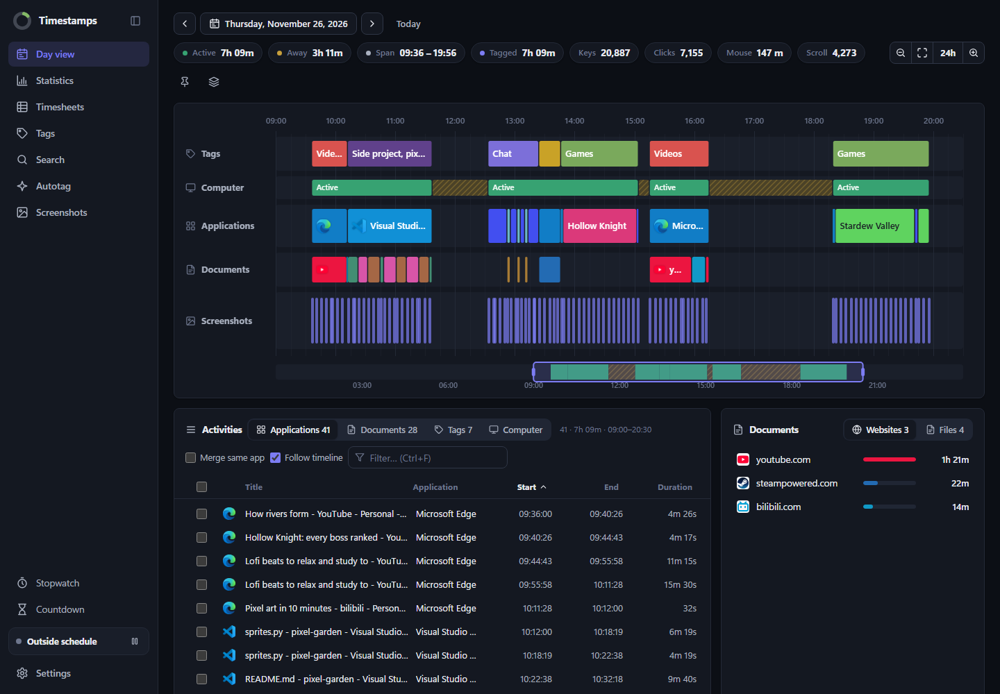
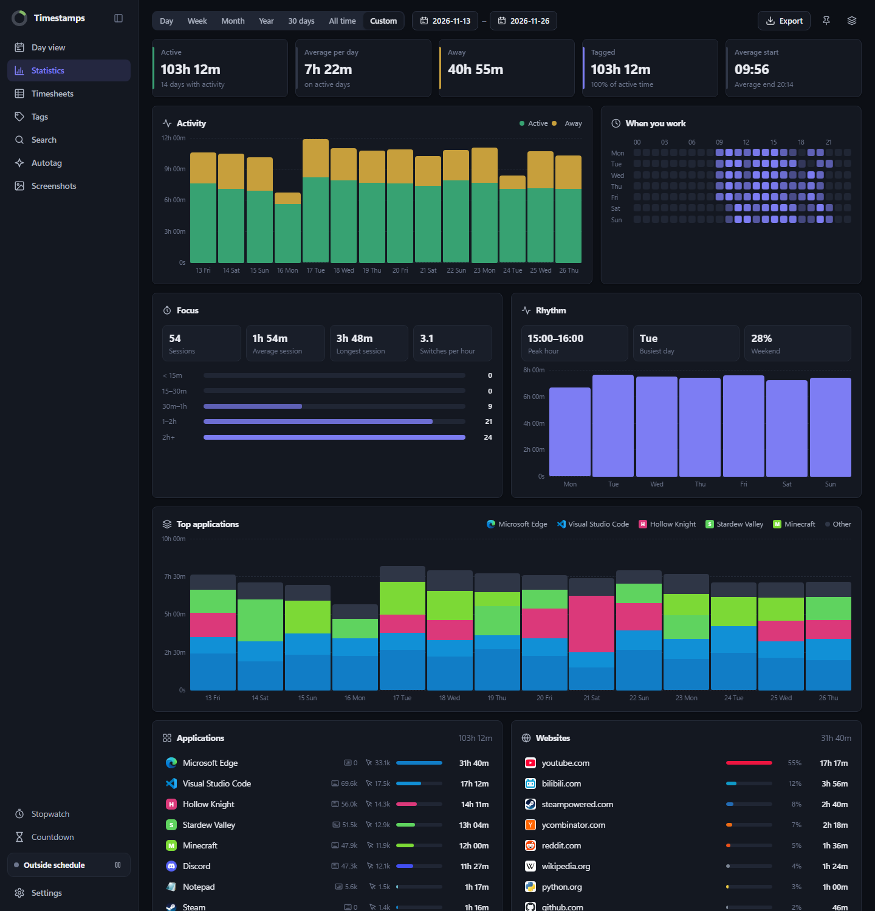

# Timestamps

**See where your day went.** Timestamps quietly records which apps,
websites and files you use on your computer, and turns it into a timeline you
can scroll through, tag and look back on. It runs on Windows and macOS, and
everything stays on your own computer.

## What it does

- **Records your day automatically.** Every app, window title, website and
  file, with real app icons. Nothing to start or stop.
- **Knows when you're away.** No input for a while, a locked screen or a
  sleeping computer counts as away, and it can ask what you were doing.
- **Takes screenshots** every few minutes, so you can see what was on screen
  at any moment. You can change or turn this off.
- **Tags your time.** Drag across the timeline and give it a name like
  *Games* or *Side project*. Rules can tag things for you.
- **Counts keys and clicks**, with a keyboard heatmap. Only how many, never
  what you typed.
- **Shows the big picture.** Statistics show active hours, your busiest days
  and hours, focus sessions and your top apps and websites.
- **Stays light.** About 50 MB of memory while it runs in the tray.

## Private by design

All your data stays in one database file on your computer. Nothing is sent
anywhere. You choose what gets recorded: for any app you can hide its window
titles, its screenshots or the app altogether, private browser windows can
show up only as "Private browsing", and tracking can follow a schedule.

## Get it

Download the latest version from
[Releases](https://github.com/ZJJ-2785/timestamps/releases):

- **Windows 10/11:** `Timestamps-Setup-<version>.exe`. It installs just for
  you, without admin rights. Windows may warn you once because the app isn't
  signed: choose *More info → Run anyway*.
- **macOS 11.3 or later:** `Timestamps-<version>-macos.zip`. Drag the app
  into *Applications*. The first time, macOS asks you to allow it; see the
  [macOS guide](docs/macos.md).

Timestamps then lives in the tray (the menu bar on a Mac). Click the icon to
open the window. It checks for updates by itself (*Settings → About*).

Coming from ManicTime or KeyStats? You can import your history in
*Settings → Data*.

## Learn more

- [User guide](docs/guide.md): every feature, keyboard shortcuts, the
  optional browser extension and where your data lives
- [macOS guide](docs/macos.md): installing, permissions and what's different
- [Building from source](docs/building.md): building, releasing and how the
  code is laid out
